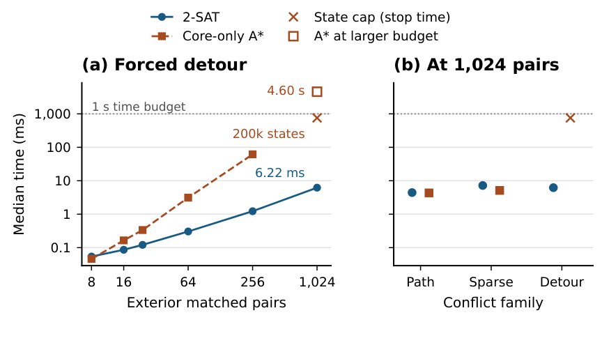

# BlockLift for independent set reconfiguration

 · 

BlockLift solves independent set reconfiguration under token jumping. It retains each local configuration's effect on the rest of the graph and its connectivity within that interface. The solver searches the resulting quotient and lifts a successful walk to legal moves on the original graph. It also includes specialized solvers and budgeted generic search.

## Problem and moves

The input is a simple undirected graph and two independent sets of equal size. A jump replaces one occupied vertex with an unoccupied vertex while preserving independence. For a current set $I$ and a candidate destination $v$, let $b_I(v)=|N_G(v)\cap I|$. If it is zero, any token can move to $v$. If it is one, the unique blocker must move. If it is at least two, the destination is unavailable in one jump. The implementation uses integer bitsets. [Command line and verification](blocklift/cli.py)

## Blocking summaries and mathematical guarantees

**Exact composition under saturation.** For an ordered block partition, let $a_i=\alpha(G[B_i])$. When the token count is $\sum_i a_i$, every block holds exactly $a_i$ tokens and every move stays within one block. At a prefix $P$, the label of a placement $X$ is $\lambda_P(X)=N_G(X)\setminus P$. An exterior independent set $Y$ is compatible exactly when $Y\cap\lambda_P(X)=\varnothing$. Contract connected components within each equal-label class. When adding a block, combine a prefix component $C$ only with compatible block configurations $Y$. The next label is the union of the previous blocked set and $N_G(Y)$, restricted to the remaining exterior. Fixed $Y$ is compatible with every representative of $C$, so each product vertex has a connected preimage. Product edges can be lifted through concrete witnesses. This is why contracting before adding a block gives the same quotient as adding the block first and then contracting.

**Separation from complete inner-boundary occupancy.** The occupied subset of the inner boundary determines the exterior blocked set. Relabeling that occupancy quotient by blocked sets and contracting again yields the blocking quotient. On a connected family formed by $b$ four-vertex paths attached to a common exterior endpoint, with the other exterior endpoint occupied, the $3^b$ distinct inner-boundary placements all block the same vertex and form one connected component. The blocking quotient has one node. Processing the paths first produces only $3b+1$ compatible product vertices in total. The comparison fixes the cut and compares these two choices of labels. The general contraction and lifting principle is related to contracted solution graphs. [Contracted solution graphs](https://doi.org/10.1007/s00236-019-00336-8)

**One vacancy.** When $\sum_i a_i-k=1$, a cross-block jump moves a token into the unique vacancy block. Contracting the within-layer connected components preserves reachability, and BFS minimizes the number of cross-block jumps. More general inputs can use bidirectional search over shared residual sets. [Single-vacancy solver](blocklift/single_vacancy.py) · [Residual-set search](blocklift/cross_block_search.py)

**Matched exterior.** Given a core $K$ of size $r$, a perfect matching of $b$ exterior pairs, and $k=b+\alpha(G[K])$, every matched pair holds exactly one token. Each pair is a Boolean variable, cross-pair conflicts are binary clauses, and blocked endpoints contribute unit clauses. A common exterior witness for a possible core jump is checked with 2-SAT. Within a reachable exterior component, variables locked by nontrivial strongly connected components retain their starting values, and remaining differing variables can be flipped in reverse topological order. BFS on the core quotient minimizes core jumps. The running-time bound is $O(n^3+2^r(r+1)^2(n+m+1))$. With equal core endpoints or one feasible direct core jump, the witness can attain the global lower bound $|T\setminus S|$. For a direct jump, taking the coordinate-wise majority of the two endpoints and a common witness gives a common assignment without needless exterior flips. [Matched-exterior experiments](experiments/matched-exterior/README.en.md)

### Witness lifting and solver branches

On a fixed quotient trajectory, weighted lifting minimizes the sum of distances between entry and exit witnesses, plus the crossing moves. That guarantee applies to the selected trajectory. Long witnesses use a DAG. Each fragment records the vertices initially required to be occupied or empty, which vertices are toggled, and its length. Concatenation propagates the requirements backward through the first fragment, combines toggles by symmetric difference, and adds the lengths. This allows direct verification of compressed witnesses. [Weighted lifting](blocklift/weighted_lifting.py) · [Compressed witness verifier](blocklift/compressed_witness.py)

The integrated solver includes closed-neighborhood equivalence, SAT gadget projection, pigeonhole gateway matching, grid parity certificates, queen search and refinement, and generic search. A result of reachable carries a validated witness. An unreachable result requires an applicable certificate or complete search. Budget exhaustion is reported separately. An endpoint-difference lower bound or additional proof is needed to certify a globally shortest path. [Solver dispatch](blocklift/orchestrator.py)

## CoRe results and ablations

The independent reproduction of the frozen solver on CoRe returns **627 reachable and 66 unreachable** outcomes. It verifies 490 explicit paths, 137 compressed witnesses, and all 66 non-reachability conclusions. Against the 575 available public lengths, the independent reproduction yields **6 shorter, 563 equal, and 6 longer**. The paper's per-instance table uses the same run for witness types and lengths. [Independent-run artifacts](experiments/matched-exterior/README.en.md)

| Validated outcomes within one second | Specialized branches off | Specialized branches on |
|---|---:|---:|
| Saturated summary off | 463 | 541 |
| Saturated summary on | 586 | 664 |

Saturated summaries add 123 net completions and specialized branches add 78. These are 61.2% and 38.8% of the incremental coverage over the configuration with both switches off. With the specialized branches enabled, the median off-to-on timing ratio on 229 comparable completions is 0.998. This experiment measures a coverage gain under the stated budget.

With the partition, block order, and pruning fixed, enabling contraction increases completion in all three repetitions from **32 to 114 of 121 cases**. Coverage improves in 13 of 14 groups. Among the 32 pairs completing in both settings, 27 use fewer product states, 26 run faster, and 12 yield longer paths after contraction. [Ablation logs and scripts](experiments/ablation/README.en.md)

## Same-objective matched-exterior scaling

Theorem 4 is tested separately with a supplied triangular core and matching. Both 2-SAT and concrete on-demand A* minimize core jumps and return a legal witness.

| Completed in all three one-second trials | Cases |
|---|---:|
| 2-SAT | 40/40 |
| Core-only A*, 20,000-state cap | 37/40 |
| Core-only A*, 200,000-state cap | 38/40 |

At 1,024 matched pairs, the methods take similar time on the path family and A* is faster on sparse cases. In the forced-detour case, 2-SAT takes 6.22 ms. A* reaches 200,000 discovered states. With a five-second budget and a one-million-state cap, A* solves the detour in all three runs, taking 4.60 s in the median run after discovering 781,839 states. The 256-pair locked case still reaches the larger cap.

[Raw logs, scripts, memory data, and replay instructions](experiments/matched-exterior/README.en.md) · [Vector figure](experiments/matched-exterior/figures/Fig4.pdf)

## Reproduce the results

Use Python 3.14. The reference runs used Windows 11, Python 3.14.2, NumPy 2.4.3, and SciPy 1.18.1. The commands below are for PowerShell. On Linux and macOS, use your virtual environment's Python executable in place of the PowerShell invocation.

~~~powershell
git clone --branch codex/ablation-reproduction https://github.com/WTY12345/BlockLift.git
cd BlockLift
py -3.14 -m venv .venv
$Python = ".\.venv\Scripts\python.exe"
& $Python -m pip install -r requirements.txt
& $Python -X utf8 -m blocklift examples/tiny.col examples/tiny.dat --output example-result.json
& $Python -X utf8 -m blocklift examples/tiny.col examples/tiny.dat --verify example-result.json
~~~

To download the pinned inputs, rerun the integrated solver and replay all results, run the following from the repository root. The largest queen input is distributed upstream as a gzip file. Allow at least 300 MB for inputs. The 15-second solver budget is checked internally, and input parsing and replay are timed separately.

~~~powershell
& $Python -X utf8 download_benchmark.py
& $Python -X utf8 run_benchmark.py --seconds 15 --output reproduction.jsonl
& $Python -X utf8 verify_benchmark.py reproduction.jsonl
~~~

The ablation tables can be reconstructed directly from their packaged data:

~~~powershell
& $Python -X utf8 experiments/ablation/ablation_metrics.py --output ablation-summary.json
~~~

The [matched-exterior reproduction guide](experiments/matched-exterior/README.en.md) gives separate commands for rebuilding the paper's CoRe table, replaying the independent run, regenerating Fig. 4, and running the same-objective cap comparison from scratch.
