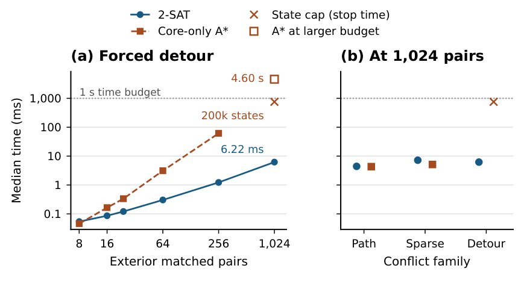

# 阻挡摘要法（BlockLift）

[](README.md) · [](README.en.md)

阻挡摘要法求解**令牌跳跃下的独立集重构**。核心做法是把局部状态的对外阻挡关系和局部连通性保留下来，在较小的状态图中搜索，再把走法还原成原图上的合法移动。对满足结构条件的实例，摘要用于精确判定可达性。通用分支也用阻挡信息生成候选，但限时搜索可能返回未判定。

## 1. 问题与单步阻挡

给定无向简单图 $G=(V,E)$ 和两个大小同为 $k$ 的独立集 $S,T$，令

$$
\mathcal I_k(G)=\{I\subseteq V:|I|=k,\ E(G[I])=\varnothing\}.
$$

重构图以 $\mathcal I_k(G)$ 为顶点。两个状态相邻，当且仅当各自恰好有一个顶点不在对方中。设 $N(X)=\bigcup_{x\in X}N_G(x)$。从当前状态 $I$ 移走 $u\in I$ 后，剩余集是 $R=I\setminus\{u\}$。合法落点满足

$$
v\notin I,\qquad v\notin N(R).
$$

实现用整数位集存储 $I$ 和邻域。令 $b_I(v)=|N_G(v)\cap I|$。若 $b_I(v)=0$，任何令牌都能跳到 $v$。若 $b_I(v)=1$，必须移开唯一阻挡它的令牌。若 $b_I(v)\ge 2$，一步跳跃无法腾出 $v$。通用束搜索用这两类可行候选推进，搜索宽度和分支限制影响其覆盖率。

## 2. 饱和分块与边界连通摘要

把顶点划分为 $B_1,\dots,B_m$，令 $a_i=\alpha(G[B_i])$。结构分支先核对容量。若 $k=\sum_i a_i$，任一合法状态在块 $B_i$ 恰好占 $a_i$ 个顶点。任何跨块跳跃都会使接收块超过容量，因此只需考虑块内移动。

处理前缀 $P_i=\bigcup_{j\le i}B_j$ 时，前缀配置 $X$ 的对外标签为

$$
\lambda_i(X)=N(X)\cap(V\setminus P_i).
$$

对同一标签 $\lambda$，只收缩该标签诱导的前缀重构图中的**同一连通分量**。两个同标签的配置仍可能无法在标签保持不变时互相到达。商图边保留实际跨分量边作为还原见证。完全枚举的最后一层对外标签为空，端点落入同一商分量恰好表示可达。

合并下一块时，枚举前缀分量 $C$ 和新块独立集 $Y$，只保留 $Y\cap\lambda_i(C)=\varnothing$ 的组合。其新标签为

$$
(\lambda_i(C)\cup N(Y))\cap(V\setminus P_{i+1}).
$$

乘积图的一条边只改变前缀分量或新块配置。固定新块配置时，同一前缀分量内的走法始终与新块兼容，因此可以用内部连接和保存的跨分量边还原商图路径。对某些结构，实现只保留从起点前缀可达的部分。

设 $q_{i-1}$ 是合并前的分量数，$\ell_i$ 是第 $i$ 块的局部配置数。朴素兼容筛选至多检查 $q_{i-1}\ell_i$ 对。给定显式乘积图后，按标签做连通收缩的扫描代价为 $O(|V_{\rm prod}|+|E_{\rm prod}|)$，另计标签和位集运算。块顺序会改变中间状态数。实现试用原序、逆序、较小活跃边界的贪心顺序和按补边数选择的消去顺序。最坏情况下中间状态量仍可能是指数级。 [边界收缩](blocklift/boundary_contraction.py) · [候选块顺序](blocklift/block_order.py)

### 数学保证与适用条件

**精确组合。** 对前缀 $P$ 和外部独立集 $Y$，$X\cup Y$ 独立等价于 $Y\cap\lambda_P(X)=\varnothing$。两个不同标签可以用其对称差中的单个外部顶点区分。固定新块配置时，前缀同标签分量的全部代表都与该配置兼容，构成乘积点的连通原像。具体边投影为乘积边或停留在原像中。每条乘积边也有具体见证，可以沿连通原像衔接。由空前缀归纳可得，在饱和划分下，先收缩再加块与先加块再收缩得到同一商图，且可恢复指定端点间的合法序列。

**内边界标签的规模分离。** 内边界 $D$ 由所有有外部邻居的前缀顶点组成。完整占用标签 $X\cap D$ 决定阻挡集合 $N(X\cap D)\setminus P$。给占用商图重新贴上阻挡标签，再收缩同标签连通分量，恰得阻挡商图。取 $b$ 个四点路径作前缀块，外部取边 $xy$，仅让 $x$ 邻接每个前缀顶点。每个路径块的三个最大独立集形成三点跳跃路径。外部占 $y$ 时，$3^b$ 种内边界占用全部互达且都只阻挡 $x$，所以占用商图有 $3^b$ 个节点，阻挡商图只有一个。该图连通且没有闭邻域相同的不同顶点。按路径块在前的顺序，累计产生 $3b+1$ 个兼容乘积顶点。比较固定同一切口和完整占用标签。同标签分量收缩及边见证衔接可见[收缩解图的通用框架](https://doi.org/10.1007/s00236-019-00336-8)。

**匹配外围的固定参数保证。** 若给定核心 $K$，外围有 $b$ 条边的完美匹配，且 $k=b+\alpha(G[K])$，每条匹配边恰有一个令牌。令每对端点为同一布尔变量的两个文字，外围跨边 $uv$ 对应 $\neg\ell_u\lor\neg\ell_v$，核心阻挡对应单位子句。固定起点赋值中被蕴含图强连通分量锁定的变量后，固定核心时可以按逆拓扑顺序翻转不同变量。核心跳跃的两侧需要同一个外围见证，因此可用一次 2-SAT 查询建一条商图边并用 BFS 最小化核心跳跃数。记 $r=|K|$，其中 $n,m$ 为原图的顶点数与边数，可在 $O(n^3+2^r(r+1)^2(n+m+1))$ 时间内判定并构造路径。核心端点重合，或可通过一次共同见证直接交接时，可达到全局最短下界 $|T\setminus S|$。直接交接时，将两端外围赋值和一个共同见证逐位取多数，仍满足两端约束，因而只需翻转两端不同的匹配对。这是附结构条件的理论保证，集成求解器的实测见下文。

## 3. 一个空额与一般跨块移动

若 $\sum_i a_i-k=1$，每个状态恰有一个空额块 $B_h$。在第 $h$ 层，只用保持空额位置的块内跳跃构建连通分量。跨块跳跃必须把令牌跳入 $B_h$，空额随后转移到令牌来源块。外层搜索以层内分量为顶点，用真实跨块跳跃作边，并保存层内父指针和跨层边的端点。外层首次到达目标分量可最小化跨块跳跃次数。还原后的总步数另受每层内部走法影响。

更一般的未饱和情况，可用块外邻域并集排除冲突，或直接按公共剩余集搜索。对任一大小为 $k-1$ 的独立集 $R$，它的所有可行扩展 $R\cup\{v\}$ 在重构图中构成一个团。双向搜索每侧只枚举一次同一个 $R$ 的扩展，而无需对每两个扩展单独检查邻接。 [单空额分层](blocklift/single_vacancy.py) · [跨块双向搜索](blocklift/cross_block_search.py) · [剩余集枚举](blocklift/residual_sets.py)

## 4. 路径还原与带权摘要

可达性收缩会隐藏块内距离。还原时按相反顺序展开各层。在给定一层及其抽象轨迹的条件下，若下一步从分量 $C_i$ 跨到 $C_{i+1}$，令当前分量内的位置为 $x$，真实跨边为 $u\to v$。设 $d_{C_i}(x,u)$ 是分量内最短距离，则

$$
F_{i+1}(v)=\min_{\substack{x\in C_i,\ (u,v)\in E_{\rm prod}\\
u\in C_i,\ v\in C_{i+1}}}
\bigl(F_i(x)+d_{C_i}(x,u)+1\bigr).
$$

最后加上到本层目标的分量内距离，再沿记录的选择回溯。实现对每个压缩片段和入口缓存可能的出口及其费用。这个最小化针对**本层给定的抽象轨迹**。原图全局最短还需要额外证明。 [显式还原](blocklift/explicit_lifting.py) · [带权还原](blocklift/weighted_lifting.py)

超长路径用由移动节点和顺序拼接节点组成的有向无环图表示。对每个片段计算四元组 $(P^+,P^-,\Delta,L)$，分别为执行前必须占用的集合、必须为空的集合、占用翻转集合和长度。单步 $u\to v$ 的摘要为

$$
(\{u\},\ \{v\}\cup(N_G(v)\setminus\{u\}),\ \{u,v\},\ 1).
$$

拼接片段时，第二段的前置条件按第一段的 $\Delta$ 反推到初始状态。落在 $\Delta$ 中的顶点交换“占用”与“为空”要求。合并全部要求并检查无冲突，翻转取对称差，长度相加。根片段要求 $P^+\subseteq S$、$P^-\cap S=\varnothing$ 且 $S\triangle\Delta=T$。核验可以按节点和引用遍历，无需逐步展开。显式导出 $L$ 步仍需 $\Omega(L)$ 的输出量。 [压缩见证与验证](blocklift/compressed_witness.py)

## 5. 结构识别与分支

| 分支 | 摘要与求解条件 |
|---|---|
| [闭邻域商图](blocklift/twin_quotient.py) | 按 $N_G[u]=N_G[v]$ 划类。每类内部是团，类间邻接一致。状态只记录占用了哪些类，搜索后还原原始顶点代表并对齐目标。 |
| [SAT 构造投影](blocklift/sat_projection.py) | 识别变量块和约束块后保留变量选择 $x$。对约束块 $Q$，记 $A_Q(x)$ 为配置 $x$ 下可占用的落点。一项变量从 $x$ 翻到 $y$，要求每个受影响的 $Q$ 都满足 $A_Q(x)\cap A_Q(y)\ne\varnothing$。这样约束令牌可以先到两侧都可用的位置，再翻变量。 |
| [鸽笼结构与匹配](blocklift/pigeonhole_matching.py) | 核对图和端点后，将打开中转点所需的配置转成行到列的注入 $\pi$。行数大于列数时不可达。可行时用最小费用匹配最小化 $\sum_i c_{i,\pi(i)}$，其中费用来自行约束换位与列冲突清理。按配置中转再逆序恢复。 |
| [方格奇偶证书](blocklift/compressed_witness.py) | 针对满足证书条件的偶边长方格和相反纯奇偶端点，按 $2\times2$ 分块，用空额 $d=|V|/2-k$ 限制多数占用色的变化。实现核对全图邻接、端点奇偶和 $(\mathrm{side}/2)^2>2d^2$ 等前提。 |
| [皇后图](blocklift/queen_search.py) | 先核对原图确为行、列、两条对角线攻击关系。维护四类占用掩码，移走皇后后枚举空行与空列的交点，筛掉对角线冲突。先找路径，再对窗口改短，必要时完整检查更短步数界。 |
| [通用调度](blocklift/orchestrator.py) | 根据图族与结构检查试用专用分支，配合阻挡束搜索、公共剩余集双向搜索及限时改短。实例名仅用于挑选候选分支。 |

对 SAT 投影，给定变量路线 $x_0,\dots,x_t$，约束块每一步的可选落点是 $A_Q(x_i)\cap A_Q(x_{i+1})$。块内的动态规划递推为 $D_{i+1}(v)=\min_u(D_i(u)+[u\ne v])$，另计首尾为匹配指定端点所需的移动。给定路线的恢复代价为 $O(t\sum_Q |Q|^2)$。若完整投影分量是一棵树，必经变量轨迹唯一。实现据此把必须的变量翻转与约束块最少移动合成最短性证明。 [SAT 投影及恢复](blocklift/sat_projection.py)

## 6. 合法性、最短性和预算

- `found` 表示已交付并验证原图路径，可另用 `--verify` 复核。
- `unreachable` 来自满足结构前提的证书，或完成搜索后证明端点不连通。搜索预算耗尽、节点超限等返回未判定类结果。
- 路径的通用下界是 $|T\setminus S|$，因为每步最多加入一个缺失的目标顶点。达到此下界时可证明最短。皇后图限长搜索使用 $h(I)=|T\setminus I|$ 剪枝，只有完整核验排除所有更短路径时才据此认证。特定结构也可给出独立下界。对照公开最佳长度与证明全局最短分别记录。 [命令行验证](blocklift/cli.py) · [限长搜索](blocklift/queen_refinement.py)

## 7. 从零复现

### 获取代码并创建环境

准备 Git 和 Python 3.14。参考实验使用 Windows 11、Python 3.14.2、NumPy 2.4.3 和 SciPy 1.18.1。以下命令以 Windows PowerShell 为例。也可从 GitHub 下载 ZIP、解压后进入仓库根目录。安装依赖及下载数据时需要网络，求解无需模型、API 密钥或 GitHub 登录。

```powershell
git clone https://github.com/WTY12345/BlockLift.git
cd BlockLift
git rev-parse HEAD
py -3.14 -m venv .venv
$Python = ".\.venv\Scripts\python.exe"
& $Python -m pip install -r requirements.txt
```

如果安装的 Python 没有 `py` 启动器，用 `python -m venv .venv`，并先确认 `python --version`。Linux 或 macOS 可用 `python3.14 -m venv .venv`，将下面 PowerShell 命令中开头的 `& $Python` 换成 `.venv/bin/python`。完整评测已在 Windows 上核验。

### 先跑一个一步样例

```powershell
& $Python -X utf8 -m blocklift examples/tiny.col examples/tiny.dat --output example-result.json
& $Python -X utf8 -m blocklift examples/tiny.col examples/tiny.dat --verify example-result.json
```

第二条命令应输出 `{"status": "verified", "length": 1}`。图文件用 DIMACS 风格的 `p` 和 `e` 行，端点用 `s` 和 `t` 行，顶点从 1 编号。`--family generic` 可用于自定义图，`--moves-out moves.txt` 可导出逐步验证的移动列表，`--quality` 尝试继续改短。

### 下载数据、运行并独立核验 CoRe 693 例

```powershell
& $Python -X utf8 download_benchmark.py
& $Python -X utf8 run_benchmark.py --seconds 15 --output reproduction.jsonl
& $Python -X utf8 verify_benchmark.py reproduction.jsonl
```

1. **下载。** 准备至少 300 MB 的数据空间。脚本从固定上游提交下载 1,212 个不同图和端点文件，解压最大的皇后图。结束时显示 `1212/1212 input files ready`。网络中断后可重跑下载脚本。 [固定数据来源](https://github.com/TakehideSoh/KR2026/tree/df807b6b6ea66b7ec37a5371c58967eecc5ce762/benchmark)
2. **运行。** 批量脚本从图和端点求解，逐例结果写入 JSONL。用相同源码、预算和输出文件可续跑。要重做完整一轮，换一个新的输出文件名。15 秒是程序检查点执行的搜索预算，输入解析及验证另计。参考机上全量 CLI 运行约 5 分钟，包含输入解析和见证核验，下载另计。
3. **独立核验。** 核验脚本不调用求解器，检查 693 个实例恰好各出现一次，重放显式路径，验证压缩见证，并复核这套数据的三类不可达结论。核验成功时参考结果为 **627 条合法路径、66 例证实不可达、0 例未判定**。它还会输出每类证据数量、相对公开步数的比较及超时统计。可把第三条命令的输入换成 `results/core-693-run.jsonl` 来核验仓库已有记录。

两轮参考实验的可达性结论逐例一致，627 条可达路径中有 5 条长度不同。请在结果中记录 Git 提交、环境、预算、状态数和路径长度差异。具体步数和耗时会受设备与定时检查影响。历史参考运行的原始记录使用其运行时归档标识，新运行记录当前源码哈希。 [693 例实验报告](reports/core-693.md) · [逐例参考记录](results/core-693-run.jsonl) · [公开方法对照](reports/comparison.md) · [七例补充实验](reports/seven-uncapped.md)

## 8. 摘要归因与跨图族消融

### 实验结论

CoRe 全量 693 例中，将饱和收缩及其路径提升与专用图族分支作为两个开关。专用开关覆盖方格证书、皇后搜索与精化、鸽笼门控和 SAT 构件投影。束搜索、公共剩余集搜索、闭邻域预处理和单空额方法为各组共用。

| 一秒内交付且核验通过 | 专用分支关 | 专用分支开 |
|---|---:|---:|
| 饱和摘要关 | 463 | 541 |
| 饱和摘要开 | 586 | 664 |

完整配置相对双关组净增 201 例。饱和摘要的边际净增为 **123（61.2%）**，专用分支为 **78（38.8%）**。分母是该预算下的净新增完成数。在专用分支开启、双方结论及路径长度相同且各耗时至少 10 毫秒的 229 个限时完成配对中，关闭摘要除以启用摘要的耗时中位比为 0.998。

固定分块、块序及剪枝，只开关同标签收缩。121 个饱和实例各运行三轮，**三轮均完成的实例从 32 增到 114**，14 组有 13 组提高。双方均完成的 32 例中，27 例少生成乘积状态、26 例更快、12 例启用后的见证更长。不同标签对照组的状态量不变，启用后用时中位数增加。该配对实验适用于选得饱和分块的实例。不同机器的耗时和接近时限的完成数可能变化。

[完整报告](experiments/ablation/README.md) · [四组逐例数据](experiments/ablation/data/factorial-693.jsonl) · [跨图族逐轮数据](experiments/ablation/data/prefix-121.jsonl) · [汇总统计](experiments/ablation/data/summary.json)

### 复现消融实验

从本仓库根目录运行，使用上节的 Python 环境与依赖。脚本核对求解器源码指纹，固定到公开快照 428f21983f234cc6cd16c948471fb68dcb2235ef。本次发布分支包含相同的求解器文件。

先从随附数据重算汇总。此步无需下载 CoRe 输入。

~~~powershell
& $Python -X utf8 experiments/ablation/ablation_metrics.py --output ablation-summary.json
~~~

再下载固定输入并从头重跑。

~~~powershell
& $Python -X utf8 download_benchmark.py
& $Python -X utf8 experiments/ablation/factorial_ablation.py --seconds 1 --output factorial-reproduction.jsonl
& $Python -X utf8 experiments/ablation/cross_family_ablation.py --seconds 1 --cap 40000 --repeats 3 --public-per-family 8 --output prefix-reproduction.jsonl
& $Python -X utf8 experiments/ablation/ablation_metrics.py --factorial factorial-reproduction.jsonl --prefix prefix-reproduction.jsonl --output ablation-rerun-summary.json
~~~

四组脚本按已有输出续跑，配对脚本要求新的输出文件。已有同版本输入时，可为两个运行脚本指定 `--inputs`，指向下载程序生成的 `benchmark/instances`。路径见证由独立核验函数在原图重放，跨图族的乘积上限按每层候选对数计算。

## 9. 定理 4 的同目标实验与论文数据

固定三点核心和给定的完美匹配，将外围从 4 对增至 1,024 对。同目标 A* 对核心跳跃收费，对外围跳跃计零成本。两组都以最少核心跳跃为目标并返回合法见证。

| 一秒内三轮均完成 | 完成数 |
|---|---:|
| 2-SAT 隐式求解 | 40/40 |
| 同目标 A*，20,000 个状态 | 37/40 |
| 同目标 A*，200,000 个状态 | 38/40 |

1,024 对的链式例上两者耗时接近，稀疏例上 A* 更快。最大绕行例中，2-SAT 中位耗时 6.22 毫秒，A* 在一秒预算下触及 20 万状态上限。将预算提高到 5 秒、100 万状态后，A* 三轮均解出该例，中位耗时 4.60 秒，发现 781,839 个状态。256 对锁定例在该扩充预算下仍触限。实验使用独立的给定核心实现。



[实验与复现说明](experiments/matched-exterior/README.md) · [矢量图](experiments/matched-exterior/figures/Fig4.pdf) · [CoRe 论文口径逐例表](experiments/matched-exterior/data/core-paper-per-instance.csv)

从仓库根目录执行下列命令可离线重算论文表格，并可重跑定理 4 实验。审稿记录统一取自第二轮独立复现，其中公开步数对照为 6 短、563 平、6 长。

~~~powershell
cd experiments/matched-exterior
python -X utf8 core_reproduction_table.py --output-dir checked
python -X utf8 summarize_matched.py --original data/matched-original.jsonl --same-objective data/matched-core-only.jsonl --large-cap data/matched-large-cap.jsonl --output checked/matched-summary.json
python -X utf8 matched_core_only.py --seconds 1 --repeats 3 --caps 20000 200000 --output matched-core-only-rerun.jsonl
~~~
