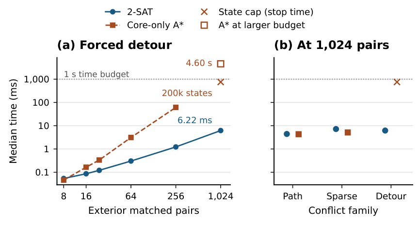

# Matched-exterior experiments and paper artifacts

  

[Project home](../../README.md)

This directory contains the independent CoRe run used in §6.2 and the fixed-core tests from §6.4. The data and benchmark scripts use relative paths and run with Python 3.14. Figure generation additionally requires Matplotlib. The reference machine ran Windows 11 on an Intel Core Ultra 9 275HX.

| Artifact | Contents |
|---|---|
| [Independent run](data/reproduced-core-693.jsonl) | All 693 outcomes, runtime, explicit move lists, and compressed witnesses |
| [Per-instance table](data/core-paper-per-instance.csv) | Witness format, both reference lengths, and the comparison and evidence category for each case |
| [Public references](data/public-reference.csv) and [audit](data/audit-summary.json) | Inputs for rebuilding and checking the table |
| [Same-objective logs](data/matched-core-only.jsonl) | 40 cases with 20,000- and 200,000-state limits, compared against 2-SAT |
| [Higher-budget logs](data/matched-large-cap.jsonl) | Three repetitions per case for two five-second tests at one million states |
| [Original comparison](data/matched-original.jsonl) | Explicit enumeration and A* with total moves as a secondary objective |
| [Summary](data/matched-summary.json) | Coverage, timing and memory for selected sizes, and the higher-budget cases |

In the independent CoRe run, 490 cases have explicit paths, 137 have compressed witnesses, and 66 are certified unreachable. Across 575 public length comparisons, the counts are 6 shorter, 563 equal, and 6 longer. [CoRe summary and source hashes](data/core-paper-summary.json)

With a one-second budget, 2-SAT completes 40/40, while core-only A* completes 37/40 at 20,000 discovered states and 38/40 at 200,000. At 1,024 pairs, A* is faster on the sparse family. In the higher-budget run A* solves the largest detour in a median 4.60 seconds. The locked control hits the one-million-state cap. Peak Python allocations are measured separately. A capped profile captures the measured part of the search.

[PDF](figures/Fig4.pdf) · [EPS](figures/Fig4.eps)

## Rebuild the numbers offline

From this directory, run:

~~~text
python -X utf8 core_reproduction_table.py --output-dir checked
python -X utf8 summarize_matched.py --original data/matched-original.jsonl --same-objective data/matched-core-only.jsonl --large-cap data/matched-large-cap.jsonl --output checked/matched-summary.json
~~~

With Matplotlib installed, regenerate both vector figure formats from the logs:

~~~text
python -X utf8 plot_matched_scaling.py --output Fig4
~~~

## Independently replay the CoRe witnesses

~~~text
python -X utf8 download_benchmark.py
python -X utf8 verify_paper_witnesses.py
~~~

The downloader pins the input revision to df807b6b6ea66b7ec37a5371c58967eecc5ce762. If these inputs are already available, pass the existing dataset directory with the --inputs option. The solver run used BlockLift commit 428f21983f234cc6cd16c948471fb68dcb2235ef. The verifier replays both witness formats, checks the structural certificates, and exhausts one small instance to confirm non-reachability.

## Rerun the scaling test

~~~text
python -X utf8 matched_core_only.py --seconds 1 --repeats 3 --caps 20000 200000 --output matched-core-only-rerun.jsonl
python -X utf8 matched_core_only.py --seconds 5 --caps 1000000 --select frozen:256 detour:1024 --output matched-large-cap-rerun.jsonl
python -X utf8 matched_exterior_experiment.py --output matched-original-rerun.jsonl
~~~

Each command generates deterministic instances and writes a new output file. Timing and borderline completions can vary by machine. The cross in Fig. 4 records stopping time at a cap. The open square reports the successful run under the higher limits.
